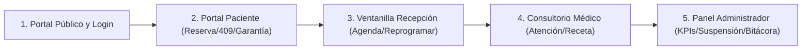

# Guion Oficial de Defensa y Demostración Práctica
## Sistema Web de Gestión de Citas Médicas — Clínica "Vida Salud"

**Fecha de Defensa:** Noviembre de 2026  
**Duración Estimada:** 10 a 12 minutos  
**Presentadores:** Equipo de Desarrollo / Estudiantes UAGRM — FCET  
**Entorno de Demostración:**
- **Frontend Oficial (Vercel):** [https://clinica-gilt-iota.vercel.app](https://clinica-gilt-iota.vercel.app)
- **Backend API (Render):** `https://clinica-backend-plaw.onrender.com`
- **Base de Datos Relacional:** PostgreSQL 16 en Supabase
- **Repositorio de Código:** [https://github.com/Dennar-Huarachi/clinica.git](https://github.com/Dennar-Huarachi/clinica.git) *(ver QR en `docs/qr-repositorio.png`)*

---

## 1. Tabla de Usuarios para la Demostración

| Rol | Nombre de Usuario | Nombre en Pantalla | Contraseña Demo | Propósito en la Defensa |
| :--- | :--- | :--- | :--- | :--- |
| **Paciente** | `paciente1` | Mario René Condori | *(Ver credenciales demo locales)* | Reserva, colisión 409, pago garantía QR, cancelación RN15, historia clínica. |
| **Recepcionista** | `recepcion1` | Lucía Fernández | *(Ver credenciales demo locales)* | Ventanilla, registro paciente, reprogramación, sala de espera. |
| **Médico** | `dr.alarcon` | Dr. Alejandro Alarcón | *(Ver credenciales demo locales)* | Agenda médica, llamada de paciente, diagnóstico CIE-10, receta, estado atendida. |
| **Administrador** | `admin` | Carlos Alberto Mamani | *(Ver credenciales demo locales)* | Dashboard, contingencia suspensión 48h, corrección RN16, bitácora, backups. |

---

## 2. Recorrido de Demostración Paso a Paso (10 Minutos)

---

### Minuto 0:00 – 01:30 | Portal Público y Autenticación Diferenciada (CU-01, CU-03)
1. **Acceso a la Portada:** Abrir `https://clinica-gilt-iota.vercel.app`. Mostrar diseño *mobile-first*, catálogo público de médicos y especialidades.
2. **Pantalla de Inicio de Sesión (`/login`):**
   - Mostrar el selector de perfil: pestaña **"Portal Pacientes"** y pestaña **"Personal de la Clínica"**.
   - *Demostración de Control de Canal:* Intentar ingresar con usuario `admin` en la pestaña de Pacientes. El sistema rechaza con alerta explicativa: *"Esta cuenta corresponde a personal clínico. Ingrese por Personal de la Clínica"*.
   - *Intento Fallido y Auditoría:* Ingresar con contraseña errónea para que quede registrado en la bitácora forense de auditoría.

---

### Minuto 01:30 – 04:00 | Portal del Paciente (CU-10, CU-12, CU-15, CU-20, CU-27)
1. **Iniciar Sesión:** Ingresar como `paciente1` con la contraseña configurada.
2. **Reserva de Cita Médica (`/citas/reserva`):**
   - Seleccionar **Especialidad:** *Medicina General*, **Médico:** *Dr. Alejandro Alarcón Paz*.
   - Elegir fecha futura (ej. semana del 9 al 20 de noviembre de 2026).
   - **Cuadrícula de Turnos (CU-10):** Mostrar los intervalos de 15 minutos (14:00, 14:15, 14:30...). Resaltar que los turnos ya comprometidos o reprogramados (como CM-0043 a las 14:00) **no aparecen en pantalla**, protegiendo la UX.
3. **Demostración de Concurrencia y Condición de Carrera (Error 409):**
   - Explicar la protección `lockForUpdate()` en transacción ACID: si dos pacientes intentan reservar el mismo turno a la misma milésima de segundo, uno es confirmado con éxito y el segundo recibe el mensaje: *"El turno médico seleccionado ya ha sido reservado por otro paciente. Por favor elija otro turno disponible"*.
4. **Pasarela de Pago de Garantía Simulada (CU-27 / D19 Humanización):**
   - Seleccionar turno libre (ej. 16:30). Elegir método **Simple QR** o **Tarjeta de Débito/Crédito**.
   - Mostrar el código QR escaneable en pantalla y el monto configurable de 50.00 Bs.
   - Presionar **"Confirmar Pago Exitoso"**. Se genera el comprobante digital con código de transacción oficial (`TX-...`).
5. **Cancelación y Política de Reembolso (RN15):**
   - Ir a **"Mis Citas Médicas"**.
   - Explicar la regla: cancelaciones con $\ge 12$ horas de anticipación liberan el turno y reembolsan la garantía; con $< 12$ horas el sistema rechaza la cancelación automática para proteger el tiempo del médico.
6. **Historial Clínico Electrónico (`/historia-clinica` / CU-20):**
   - Mostrar antecedentes patológicos, consultas anteriores, diagnósticos CIE-10 y resultados de laboratorio adjuntos.
   - Demostrar la regla **RN19 Anti-IDOR**: si el paciente altera la URL a otro ID de paciente, el backend responde **403 Forbidden**.

---

### Minuto 04:00 – 06:00 | Ventanilla de Recepción (CU-05, CU-13, CU-14)
1. **Cambio de Usuario:** Cerrar sesión e ingresar como `recepcion1`.
2. **Agenda General de Citas (`/recepcion/citas`):**
   - Mostrar la vista operativa con `TablaExpandible.jsx` adaptada a teléfonos y tablets sin barras de desplazamiento horizontal.
   - Filtros dinámicos por médico, fecha y especialidad.
3. **Registro de Paciente en Ventanilla (CU-05):**
   - Mostrar cómo recepción empadrona pacientes sin cuenta web previa, generando su número de historia clínica correlativo (`HC-00xx`).
4. **Reprogramación de Turno (CU-12):**
   - Localizar una cita activa, reprogramarla a una nueva fecha/hora y verificar que el turno original queda inmediatamente libre para agendamiento.
5. **Recepción en Sala de Espera (CU-13):**
   - Pasar la cita de un paciente que llega a la clínica de estado `Programada` a `En Sala de Espera` (ID 4).

---

### Minuto 06:00 – 07:30 | Consultorio Médico (CU-17, CU-18, CU-19)
1. **Cambio de Usuario:** Ingresar como `dr.alarcon`.
2. **Agenda Profesional del Médico:**
   - La agenda se carga aislada estrictamente para el médico autenticado. No ve pacientes de otros consultorios (RN19).
3. **Atención Médica y Diagnóstico (CU-18):**
   - Seleccionar al paciente en espera y pulsar **"Llamar a Consulta / Registrar Atención"**.
   - Diligenciar formulario clínico: Motivo de consulta, Examen físico (signos vitales), Diagnóstico (CIE-10), Tratamiento e indicaciones, y Receta médica farmacéutica.
   - Pulsar **"Guardar Atención Médica"**.
   - **Transición Automática:** La cita pasa atómicamente a estado **Atendida** (ID 5), la atención se sella y queda registrada en el expediente inmutable.
4. **Kardex Digital de Pacientes (`/medico/pacientes` / CU-17):**
   - Visualizar la ficha de pacientes recurrentes con historial acumulado de visitas y alertas médicas (alergias a penicilina, hipertensión, etc.).

---

### Minuto 07:30 – 10:00 | Panel de Administración y Control Forense (CU-04, CU-11, CU-21 a CU-26)
1. **Cambio de Usuario:** Ingresar como `admin`.
2. **Dashboard Ejecutivo (`/admin/dashboard` / CU-25):**
   - Tarjetas KPI: Pacientes empadronados, citas atendidas hoy, efectividad de asistencia ($\%$) y balance financiero de depósitos de garantía (completados, reembolsados y retenidos).
3. **Gestión de Contingencias y Suspensión de Horarios (CU-11 / RN17):**
   - Ir a `/admin/suspensiones`.
   - Mostrar la suspensión médica por emergencia de la Dra. Torres.
   - Demostrar que las citas colisionadas pasaron automáticamente a estado **Postergada** (ID 9), se bloquearon turnos y se otorgó a los pacientes una **ventana de prioridad de 48 horas** con botón de reubicación prioritaria.
4. **Corrección Autorizada de Citas (RN16):**
   - Mostrar cómo un Administrador (y únicamente este rol) puede corregir una cita cerrada entre `Atendida` e `Inasistencia` ingresando obligatoriamente el motivo de la corrección, registrándose en auditoría forense.
5. **Reportes Operacionales y Exportación (CU-21, CU-22, CU-23):**
   - Filtrar citas por rango de fechas y médico.
   - Presionar **"Exportar a Excel / CSV"**: mostrar que descarga un archivo formateado con codificación `UTF-8 BOM` que abre con acentos y caracteres especiales limpios en Microsoft Excel.
6. **Bitácora Forense de Auditoría (`/admin/bitacora` / CU-24 / RN21):**
   - Mostrar el registro cronológico inmutable: caso de uso, acción, IP de origen, usuario operador, y el JSON comparativo de datos anteriores y datos nuevos.
   - Resaltar que el intento fallido de contraseña ejecutado en el Minuto 1 está registrado allí.
7. **Copias de Seguridad (`/admin/backups` / CU-26 / RN22):**
   - Presionar **"Generar Copia de Seguridad"**. Se genera en segundos el volcado SQL estructurado descargable para contingencias.

---

## 3. Banco de 15 Preguntas Probables de la Docente y Respuestas Técnicas

### 1. ¿Cómo manejan la concurrencia cuando dos pacientes quieren reservar el mismo turno al mismo milisegundo?
**Respuesta:** Mediante transacciones atómicas `DB::transaction()` y bloqueo pesimista a nivel de fila con `lockForUpdate()` en PostgreSQL (`Cita::querySolapamiento()`). La primera solicitud en ser atendida por el motor adquiere el candado exclusivo de lectura/escritura; la segunda solicitud espera la resolución de la primera y, al comprobar que el turno ya fue ocupado, arroja una excepción con código **HTTP 409 Conflict**, devolviendo un mensaje comprensible al paciente sin corromper la agenda.

### 2. ¿Cómo se protegen las contraseñas en la base de datos?
**Respuesta:** Las contraseñas nunca se guardan en texto plano. Se procesan mediante la función criptográfica `Hash::make()` de Laravel, que implementa el algoritmo **Bcrypt** con un factor de costo (*work factor*) de 12 y *salt* aleatorio por cada usuario. Las comparaciones se ejecutan de manera segura con `Hash::check()`, inmune a ataques de tiempo (*timing attacks*).

### 3. ¿Cómo evitan que un paciente vea o modifique citas o expedientes ajenos alterando el ID en la URL (IDOR)?
**Respuesta:** Aplicamos el principio de mínima confianza y la regla **RN19**. En los controladores (`GestionarCitasControlador`, `ConsultarHistorialClinicoControlador`), si el usuario autenticado tiene rol `paciente`, el sistema ignora cualquier `id_paciente` que venga en la petición o verifica que coincida estrictamente con el ID vinculado en su token de sesión criptográfica. Si hay discrepancia, se deniega el acceso con **HTTP 403 Forbidden** antes de tocar la base de datos.

### 4. ¿Cuáles son los estados posibles de una cita y qué impide que una cita cancelada se reactive (RN16)?
**Respuesta:** Contamos con 9 estados catalogados: `pendiente`, `programada`, `confirmada`, `en_espera`, `atendida`, `cancelada`, `inasistencia`, `reprogramada` y `postergada`. La regla **RN16** en `RegistrarAsistenciaServicio` y `GestionarCitasServicio` valida que si una cita tiene estado `cancelada` (ID 6), se aborta cualquier intento de marcarla como asistida o atenderla, obligando a generar una nueva cita para no falsear las estadísticas históricas.

### 5. ¿Cómo funciona la regla de cancelación y reembolso de garantía (RN15)?
**Respuesta:** El parámetro configurable del sistema `HORAS_ANTICIPACION_CANCELAR` (fijado en 12 horas) se evalúa comparando la fecha y hora del turno contra la hora actual en zona horaria boliviana (`America/La_Paz`). Si la diferencia es $\ge 12$ horas, el depósito de garantía en `pagos_cita` pasa a estado `reembolsado` y el turno se libera. Si es menor a 12 horas, la garantía se marca como `retenida` por penalización de inasistencia/tardanza.

### 6. ¿Qué ocurre cuando un médico sufre una contingencia y suspende su horario (RN17)?
**Respuesta:** En `SuspenderHorarioServicio` (CU-11), al registrar la suspensión médica se buscan las citas afectadas dentro del intervalo. Estas citas pasan automáticamente a estado `postergada` (ID 9), se activa la bandera `es_postergada = true` y se les asigna una fecha de expiración de reserva de **48 horas**. Durante ese lapso, el paciente tiene prioridad exclusiva para reubicar su turno sin costo adicional, y el horario suspendido queda bloqueado para nuevos agendamientos.

### 7. ¿Por qué la bitácora es inmutable y qué información registra (RN21)?
**Respuesta:** La tabla `bitacora_auditoria` no tiene rutas ni métodos de actualización (`UPDATE`) ni borrado (`DELETE`). Cada evento crítico almacena: ID de usuario, caso de uso (`CU`), acción técnica, tabla afectada, ID del registro, dirección IP de origen, agente de usuario (*User-Agent*), marca de tiempo precisa y dos campos JSON: `datos_anteriores` y `datos_nuevos`, permitiendo trazabilidad y reconstrucción forense completa de cualquier cambio.

### 8. ¿Cómo impiden que un paciente reserve en línea una especialidad que es únicamente presencial (RN18)?
**Respuesta:** En la tabla `especialidades` existe la columna booleana `reservable_en_linea`. Tanto el servicio de disponibilidad (`ConsultarDisponibilidadServicio`) como el validador de reserva (`GestionarCitasServicio`) comprueban si el rol del operador es `paciente` y si `reservable_en_linea == false`. Si es así, se bloquea la consulta y el agendamiento arrojando **HTTP 403 Forbidden**, indicando que debe acudir a recepción.

### 9. ¿Cómo garantizan la atomicidad si el servidor se apaga o falla la red a mitad de una reserva?
**Respuesta:** Toda operación multientidad (como agendar una cita, que inserta en `citas`, registra en `pagos_cita` y audita en `bitacora_auditoria`) se ejecuta dentro de bloques transaccionales `DB::transaction(function () { ... })`. Si ocurre cualquier error, PostgreSQL realiza un `ROLLBACK` total automático, garantizando que no queden pagos huérfanos ni citas a medio registrar (propiedad ACID).

### 10. ¿Cómo está protegido el sistema contra inyecciones SQL y ataques Cross-Site Scripting (XSS)?
**Respuesta:**
- **SQL Injection:** No se concatenan cadenas directas en las sentencias SQL. Se utiliza el ORM y Query Builder de Laravel con sentencias preparadas y parámetros vinculados (*PDO Parameter Binding*).
- **XSS:** La clase base `FormRequestPersonalizado` ejecuta en `prepareForValidation()` una sanitización recursiva de todas las entradas de texto libre mediante `strip_tags()` antes de que lleguen a la lógica del negocio. En React, el motor de plantillas JSX escapa por defecto cualquier contenido renderizado en el DOM.

### 11. ¿Cómo mitigan ataques de fuerza bruta en los formularios de inicio de sesión?
**Respuesta:** Mediante el middleware de rate limiting de Laravel configurado en la ruta `/acceso/login` como `throttle:5,1`. Esto restringe las solicitudes a un máximo de 5 intentos por minuto por cada dirección IP. Al excederse, el servidor responde automáticamente con **HTTP 429 Too Many Requests**, neutralizando ataques automatizados de diccionario.

### 12. ¿Qué pasa si un paciente ya fue atendido en ventanilla y después decide registrarse por la web?
**Respuesta:** El servicio `RegistrarsePacienteServicio` (CU-03) busca si el CI ya existe en la tabla `personas`. Si existe pero no tiene usuario, compara los nombres y apellidos normalizados. Si coinciden, crea la cuenta de usuario y la enlaza a su historia clínica preexistente (`HC-00xx`), conservando todas sus atenciones pasadas. Si los nombres no coinciden, rechaza la operación con HTTP 422 para impedir suplantación de identidad.

### 13. ¿Qué mecanismo previene que el sistema se quede sin administradores por error?
**Respuesta:** En `AdministrarUsuariosRolesServicio`, antes de desactivar a un usuario o retirarle el rol de Administrador, se ejecuta una consulta que verifica si existe más de un administrador con estado `activo`. Si se trata del último administrador del sistema, la transacción se aborta con HTTP 422 y un mensaje de protección institucional.

### 14. ¿Cómo resolvieron el problema de zonas horarias entre Render (UTC) y la Clínica en Bolivia?
**Respuesta:** En `config/database.php` se fijó `'timezone' => 'America/La_Paz'`, forzando a PostgreSQL a trabajar en UTC-4. Además, en todos los servicios que realizan cálculos de horas críticas (`Carbon::now('America/La_Paz')`, `Carbon::today('America/La_Paz')`) se declara la zona horaria de forma explícita, garantizando que ni el cálculo de 12h de anticipación ni los reportes dependan de la zona horaria del servidor donde esté alojado el contenedor Docker.

### 15. ¿Cómo se respalda la base de datos y quién puede restaurar una copia (RN22)?
**Respuesta:** El módulo CU-26 genera volcados estructurados SQL con esquema y datos utilizando la transacción de base de datos y los almacena en almacenamiento seguro. Las rutas y los métodos de controlador (`GenerarRestaurarCopiasSeguridadControlador`) cuentan con una verificación estricta de doble capa que restringe la generación, descarga y restauración **exclusivamente al rol Administrador**, auditando cada restauración en la bitácora forense.

